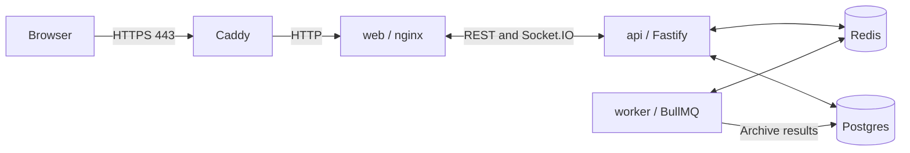

# Quarrel deployment notes

Deployment notes. Deployed once on AWS for practice; the server has since been discontinued and is not maintained.

## What this is

Retained notes and configuration for running Quarrel on one small Linux server with HTTPS.
Quarrel was deployed once on AWS for practice; the server has since been discontinued.
The project runs locally through Docker Compose, and these files are kept for reuse.

## Architecture



1. Caddy redirects HTTP to HTTPS, terminates TLS and proxies requests to web:80.
2. nginx serves the UI and proxies `/api` and `/socket.io` to api:4000, including WebSockets.
3. API uses Redis live state and Postgres archives; the worker handles queued work and archives.
4. Only 80/tcp, 443/tcp and 443/udp are public. web, api, worker, Redis and Postgres are internal.

## Files

| File | Purpose |
| --- | --- |
| [README.md](README.md) | Status, architecture, reference setup and trade-offs. |
| [Caddyfile](Caddyfile) | SITE_HOST, automatic HTTPS, compression, headers and proxy to web. |
| [env.production.example](env.production.example) | Placeholder-only server settings; copy privately to .env.local. |
| [../docker-compose.prod.yml](../docker-compose.prod.yml) | Production override: Caddy, internal app services, restart/log policies and memory settings. |

## Reference setup for reuse

- One AWS EC2 t3.small: Ubuntu 24.04 LTS, 2 GB RAM and 2 GB swap.
- An Elastic IP; a security group allowing public 80/443 and SSH restricted to one trusted IP.
- A free DuckDNS hostname pointing at that IP before Caddy requests automatic certificates.
- A server-only .env.local with real credentials, `COOKIE_SECURE=true` and `TRUST_PROXY=true`.
- Real Gemini on its free tier, using `JUDGE_AI_MODE=auto`, with same-key model fallback.

A Linux VM from another provider with Docker, enough memory/disk and equivalent public
network access can use the same Compose setup; replace the AWS-specific console steps.

## Status

Quarrel was deployed once on AWS to practice the full server, DNS, HTTPS and Docker Compose
setup. The instance was then removed: an always-on server has an ongoing operating cost,
and a public instance is not needed for this portfolio/hackathon project. No live instance
is maintained; the notes and configuration are retained for reuse. Temporary credits may
offset costs under the [AWS Free Plan](https://docs.aws.amazon.com/awsaccountbilling/latest/aboutv2/free-tier-plans.html).

Budget roughly **USD 20/month** for the reference setup before credits. This is approximate,
not a quote; region, current [AWS pricing](https://aws.amazon.com/ec2/instance-types/t3/),
disk, public IPv4 and usage affect the total. The combined Postgres/Redis, Node API/worker and
proxy stack is planned above the 1 GB t3.micro footprint, at 2 GB plus swap. This is a capacity
budget, not a measured minimum; no runtime/build capacity measurements are recorded here.

## How to deploy it again

The ordered commands and checks are in the [deployment runbook](../agent-docs/deploy.md).
To recreate a server using the retained configuration:

1. Create the server and its restricted network access.
2. Point the DuckDNS hostname at the server's public IP.
3. SSH in, update Ubuntu, configure swap and install Docker with the Compose plugin.
4. Clone the repo, copy the env template to server-only .env.local and fill it privately.
5. From the repo root, run the runbook's production command:

   ```bash
   docker compose -f docker-compose.yml -f docker-compose.prod.yml --env-file .env.local up -d --build
   ```

6. Follow the runbook's post-launch checklist: HTTPS, health, Secure cookies, two devices
   including mobile data, and internal services unreachable from outside.

These notes make no load-testing or production-hardening claims. No hosted performance
or verification results are recorded here.

## Known trade-offs

- **No database backup, by decision.** Postgres archives live in a named volume on the server
  disk. Redis is live state/queues only; host or volume loss can lose data and active games.
- **Single server.** Updates have downtime. The multi-server/Socket.IO Redis-adapter scale
  step remains on the [to-do list](../agent-docs/todo.md#later-stages).
- **Free-tier Gemini quotas.** Model fallback, simpler text fallbacks, delayed verdict retry
  and voice silence on daily exhaustion are documented in the
  [quota API behavior](../docs/api.md#free-tier-ai-status-and-room-attempt-limits).
